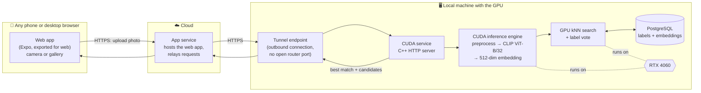
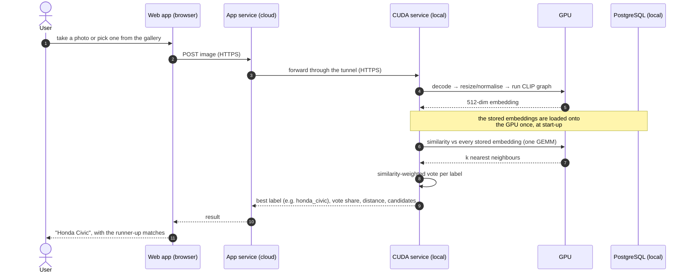
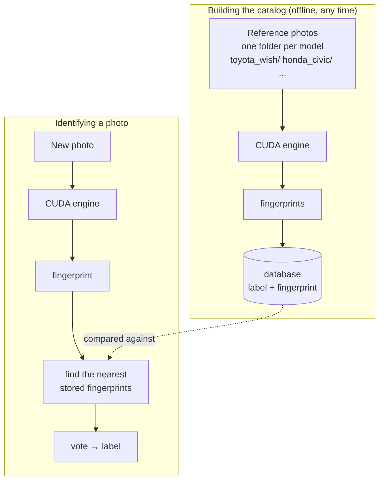
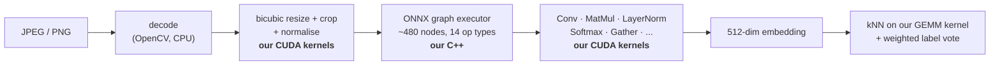
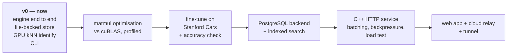

# Fine-grained vehicle identification

Take a photo of a car on your phone and get back its make and model: *Toyota
Wish*, *Honda Civic*, and so on. The photo goes from a web app in the browser,
through the cloud, to a **hand-written CUDA inference engine** running on a
local GPU. The engine compares the photo against a database of reference
images and returns the closest match.

> **Current version: prototype v0.** The CUDA engine works end to end from the
> command line: it embeds images, stores them, and identifies new images by
> nearest-neighbour search on the GPU. The network service, the Postgres
> database and the mobile web app are not built yet. See [Status](#status).

The engine is the core of the project, and it is built from scratch: our own
CUDA kernels and our own ONNX graph executor, with no ONNX Runtime, cuBLAS or
TensorRT in the path that serves a request. Details are in
**[CUDA/README.md](CUDA/README.md)**.

## How it fits together



**Why the GPU stays at home.** Renting a cloud GPU around the clock to serve a
demo costs far more than the local card. The GPU work happens on a local
machine; only the lightweight web app runs in the cloud.

**Why a tunnel rather than port forwarding.** The phone loads the app over
HTTPS, and browsers block an HTTPS page from calling a plain-HTTP address
("mixed content"). So the GPU machine needs an HTTPS address that the cloud can
reach. Forwarding a router port works, but it exposes the home IP and needs a
DNS name and a TLS certificate. It also fails outright if the ISP uses
carrier-grade NAT. An outbound tunnel (Cloudflare Tunnel, Tailscale Funnel,
ngrok) gives the local service an HTTPS address without opening any inbound
port. The final choice is still open.

## What happens to one photo



## Identifying by similarity, not by fixed classes

A conventional classifier has one output per known car model. Teaching it a new
model means retraining. This project instead turns every image into a
**fingerprint** (an embedding: 512 numbers) and identifies a photo by finding
the most similar stored fingerprints.



- **Adding a model is a data change, not a retrain.** Drop a folder of
  photos into the catalog and that model can be recognised. This matters for
  models that public datasets miss. Stanford Cars, the standard benchmark, covers
  US-market cars up to 2012, so a regional model like the Toyota Wish has to come
  from your own photos.
- **The domain is configuration.** The engine only sees a `[N, 3, 224, 224]`
  image tensor. Cars are just the first catalog; flowers or birds would be a
  different set of folders.

## Components

| Component | Where | What it is | State |
|---|---|---|---|
| **CUDA inference engine** | [`CUDA/`](CUDA/README.md) | Hand-written CUDA kernels and ONNX graph executor running CLIP ViT-B/32's vision encoder; preprocessing on the GPU; embedding store; GPU brute-force kNN | **v0 working**, as a command-line tool |
| CUDA service | `CUDA/src/server/` (planned) | C++ HTTP server around the engine: request handling, dynamic batching, backpressure | planned |
| Database | local PostgreSQL | Catalog of labels and embeddings. The engine already talks to storage through a proxy interface; a local file backend stands in for Postgres today | file backend only |
| Web app | [`app/`](app/) | Expo (React Native) app, exported for the web so any phone browser can use it; camera or gallery upload | starter template |
| App service | cloud | Hosts the web app and relays requests to the local CUDA service | planned |
| Offline Python | [`CUDA/python/`](CUDA/python/) | Model export to ONNX, reference outputs for correctness checks, later fine-tuning | export working |

### The CUDA engine in one picture



Correctness is checked node by node against ONNX Runtime, which is used only as
a test oracle and is never linked into the serving path. Commands, storage
format, kernels and benchmarks: **[CUDA/README.md](CUDA/README.md)**.

### Is Expo a good fit for the web app?

Yes. Expo Router builds for the web through `react-native-web`, and this repo is
already set up for it: `app.json` has a `web` target with static output. A
static web export can be hosted on any static host or cloud bucket, and phone
browsers can open it with nothing installed. `expo-image-picker` works in the
browser too: on a phone it offers the camera and the photo library through the
browser's own file picker. The same code can later become native iOS and
Android apps. If the relay also needs to live in the app, Expo Router can serve
API routes from a server build. Otherwise a small separate service does that
job.

## Status

**Prototype v0.** What works today, run from the command line on the GPU
machine:

```bash
# Build a catalog: one folder per model, the folder name is the label
cuda add   --storage data --images "photos/catalog/"

# Identify photos against it
cuda infer --storage data --images "photos/query/"

# Maintain it
cuda read   --storage data
cuda update --storage data --images "photos/catalog/honda_civic/"
cuda delete --storage data --label toyota_wish
```



## Repository layout

```
.
├── README.md            this file: the whole system
├── app/, assets/        Expo web app (starter template for now)
├── app.json, package.json
├── cuda.sln             Visual Studio solution for the engine
└── CUDA/                the CUDA inference engine; see CUDA/README.md
    ├── src/             kernels, graph executor, storage, search, tests
    ├── python/          offline: ONNX export, reference outputs
    ├── tools/           GPU clock locking, profiling scripts
    └── BENCHMARKS.md    append-only measurement log
```

## Getting started

**CUDA engine** (Windows, Visual Studio, CUDA, RTX-class GPU). Build
instructions, model export and every command are in
[CUDA/README.md](CUDA/README.md). The short version:

```bash
msbuild cuda.sln /p:Configuration=Release /p:Platform=x64
```

**Web app** (Node.js):

```bash
npm install
npx expo start --web
```
